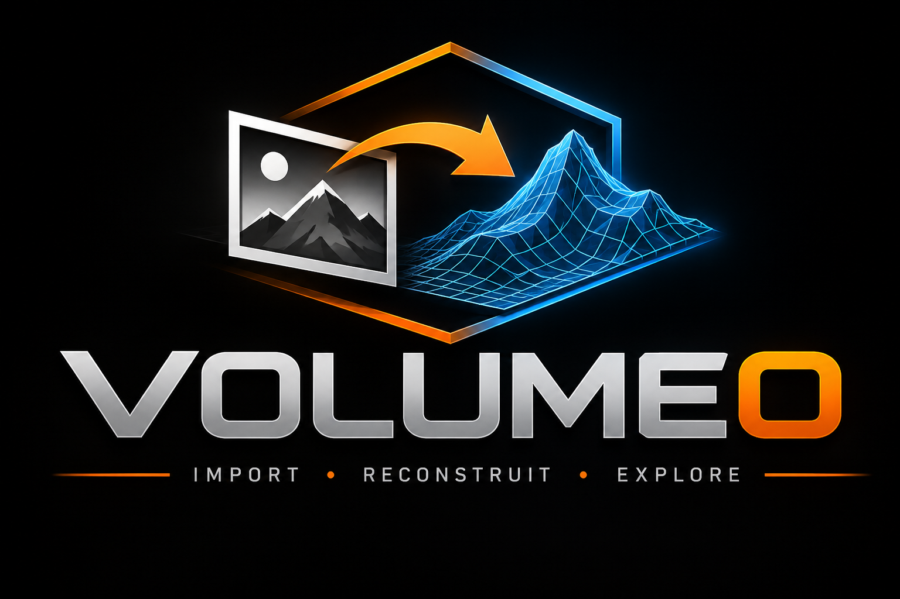

<p align="center"></p>

# Volumeo

Application web qui transforme une image (JPG, PNG, WebP), une description écrite, ou les deux, en modèle 3D texturé d'un objet, d'un personnage ou d'un véhicule, à visualiser dans le navigateur puis à télécharger en GLB, OBJ, STL ou FBX.


## Fonctionnalités

- Import par glisser-déposer, suppression automatique de l'arrière-plan (rembg) et aperçu avant/après.
- Trois façons de partir : une image seule, une description seule (« un robot jouet rouge »), ou une image accompagnée d'une description qui la transforme (« en or massif », « avec des ailes ») avant le passage en 3D.
- Résolution du maillage : Brouillon (~5 000 triangles), Standard (~50 000), Haute (~200 000) ou Personnalisée (500 à 500 000 triangles, texture 512 / 1024 / 2048 / 4096 px).
- Génération par un modèle image-to-3D interchangeable : TripoSG (forme précise, carte NVIDIA conseillée), TripoSR (rapide, fonctionne aussi sur CPU), générateur procédural CPU en secours.
- Post-traitement : nettoyage, décimation ou subdivision vers le nombre de triangles visé, lissage de Taubin, remaillage isotrope optionnel, dépliage UV (xatlas) et bake de la texture.
- Visionneuse Three.js : rotation, zoom, éclairage réglable, modes texturé / uni / fil de fer, arêtes, nombre de triangles.
- Exports GLB, OBJ + MTL + PNG (zip), STL (Z vers le haut, 100 mm, prêt pour l'impression) et FBX 7.4 binaire avec texture embarquée.
- File d'attente (une génération à la fois), barre de progression, annulation, historique persistant.
- « Ajuster le modèle affiché » : change résolution, texture et lissage d'une génération existante sans relancer l'IA.

## Installation sous Windows (logiciel)

1. Téléchargez `Volumeo-windows.zip` depuis la page [Releases](https://github.com/Panics78390/Volumeo/releases) et décompressez-le où vous voulez.
2. Double-cliquez sur **`Installer Volumeo.bat`**. Il installe Python si besoin (via winget), les dépendances, PyTorch (version CUDA si une carte NVIDIA est détectée) et le code de TripoSR et TripoSG, puis crée un raccourci **Volumeo** sur le Bureau. Comptez 5 à 15 minutes et 3 à 6 Go de disque.
3. Lancez Volumeo avec le raccourci : l'application s'ouvre dans sa propre fenêtre.

Les images, modèles générés, l'historique et les poids téléchargés sont rangés dans `%LOCALAPPDATA%\Volumeo`. Les poids sont copiés dans ce dossier sans liens symboliques, donc ni le mode développeur ni les droits administrateur ne sont nécessaires. Le journal est dans `%LOCALAPPDATA%\Volumeo\volumeo.log`. Pour désinstaller, supprimez ce dossier, le dossier décompressé et le raccourci.

Options de l'installateur : `"Installer Volumeo.bat" -NoAI` (sans PyTorch ni modèles d'IA) ou `-Cpu` (PyTorch CPU même avec une carte NVIDIA). Depuis un clone du dépôt plutôt que le zip, Node.js est nécessaire pour compiler l'interface.

## Démarrage rapide (Docker)

```bash
docker compose up --build
# puis ouvrir http://localhost:8000
```

Avec un GPU NVIDIA :

```bash
docker compose -f docker-compose.yml -f docker-compose.gpu.yml up --build
```

Image légère sans PyTorch ni TripoSR (générateur procédural uniquement) :

```bash
INSTALL_AI=0 docker compose up --build
```

Les volumes `data` (images, modèles générés, historique) et `models` (poids téléchargés) survivent aux redémarrages.

## Prérequis GPU

| | Minimum | Recommandé |
|---|---|---|
| GPU | aucun (CPU) | NVIDIA, 8 Go de VRAM (TripoSR en utilise environ 6, TripoSG 8) |
| Pilote | — | pilote NVIDIA récent + [NVIDIA Container Toolkit](https://docs.nvidia.com/datacenter/cloud-native/container-toolkit/latest/install-guide.html) pour Docker |
| RAM | 8 Go | 16 Go |
| Disque | 3 Go | 10 Go (image CUDA + poids) |

Sans GPU CUDA, l'application démarre quand même : un avertissement s'affiche dans les logs et dans l'interface (« CPU uniquement »), et TripoSR tourne sur CPU (de 30 s à plusieurs minutes par génération selon la résolution). TripoSG reste utilisable sur CPU mais demande alors de longues minutes ; il n'est choisi d'office qu'avec un GPU. Le périphérique se force avec `I3D_DEVICE=cpu` ou `I3D_DEVICE=cuda:1`.

## Poids des modèles

Rien à télécharger à la main dans le cas général : au premier lancement, les poids sont récupérés automatiquement et mis en cache dans le volume `models`.

| Modèle | Source | Taille | Usage |
|---|---|---|---|
| TripoSR | Hugging Face `stabilityai/TripoSR` (`config.yaml`, `model.ckpt`) | ~1,7 Go | génération 3D |
| TripoSG | Hugging Face `VAST-AI/TripoSG` | plusieurs Go | génération 3D précise |
| DINO ViT-B/16 | Hugging Face `facebook/dino-vitb16` (`config.json` seulement) | quelques Ko | encodeur d'image de TripoSR |
| IS-Net | GitHub (rembg) | ~170 Mo | suppression de l'arrière-plan |
| SDXL-Turbo | Hugging Face `stabilityai/sdxl-turbo` | ~7 Go | description → image, avec carte NVIDIA |
| SD-Turbo | Hugging Face `stabilityai/sd-turbo` | ~2,5 Go | description → image, sur CPU |

Ces poids sont publics, aucun compte ni jeton Hugging Face n'est requis. Le modèle de description n'est téléchargé que la première fois qu'une description est utilisée.

Pour une machine sans accès Internet, téléchargez-les ailleurs puis copiez-les :

```bash
pip install huggingface_hub
huggingface-cli download stabilityai/TripoSR config.yaml model.ckpt --local-dir models/TripoSR
huggingface-cli download facebook/dino-vitb16 config.json        # reste dans le cache HF
# puis : I3D_TRIPOSR_MODEL=/models/TripoSR  et  HF_HUB_OFFLINE=1
```

## Installation locale (développement)

Prérequis : Python 3.10 à 3.13, Node.js 20+, et sous Debian/Ubuntu `sudo apt install libgl1 libopengl0 libglx0 libegl1` (plugins PyMeshLab).

```bash
# Backend
cd backend
python -m venv .venv && source .venv/bin/activate
pip install -r requirements-dev.txt

# Optionnel : TripoSR et TripoSG
pip install torch                       # ou --index-url https://download.pytorch.org/whl/cpu pour une version CPU
pip install -r requirements-ai.txt
git clone https://github.com/VAST-AI-Research/TripoSR ../third_party/TripoSR
git clone https://github.com/VAST-AI-Research/TripoSG ../third_party/TripoSG
export PYTHONPATH=$PWD/../third_party/TripoSR:$PWD/../third_party/TripoSG

uvicorn app.main:app --reload --port 8000

# Frontend (autre terminal)
cd frontend
npm install
npm run dev          # http://localhost:5173, /api est relayé vers le port 8000
```

`torchmcubes`, requis par le dépôt TripoSR d'origine et pénible à compiler, n'est pas nécessaire : l'extraction de surface passe par scikit-image. De même, `diso` (décodeur rapide de TripoSG, extension CUDA à compiler) est remplacé par le décodeur hiérarchique du dépôt, lui aussi basé sur scikit-image.

### Comment TripoSG est intégré

TripoSG produit une forme sans couleur, dans le repère propre de l'objet. Volumeo :

1. cherche la rotation (axe vertical, cap, hauteur de la caméra) dont la silhouette ressemble le plus à celle de la photo, pour tourner le modèle comme sur l'image ;
2. si TripoSR est installé, le fait reconstruire le même objet en couleur et s'en sert pour départager les orientations ambiguës (avant ou arrière d'une voiture) ;
3. colle les pixels nets de la photo sur les faces que l'objectif voit vraiment (test de profondeur, fondu selon l'angle) ;
4. si la forme est symétrique (une voiture de gauche à droite, par exemple), colore le côté caché avec le reflet du côté visible ;
5. pour le reste (l'arrière, le dessous), reprend les couleurs de TripoSR, ou à défaut une projection de la photo.

En résolution Brouillon et Standard, TripoSG décode sa forme sur une grille 256³ ; la grille 512³, nettement plus lente, est réservée à la résolution Haute.

## Utilisation

1. Déposez une image, écrivez une description, ou faites les deux. Avec une image, le détourage s'affiche et « Voir l'original » permet de comparer. Avec les deux, le curseur « Liberté de l'IA » règle à quel point la description peut s'éloigner de l'image.
2. Choisissez une résolution, et si besoin la taille de texture et le lissage.
3. Choisissez le modèle de génération, puis « Générer le modèle 3D ».
4. Inspectez le résultat dans la visionneuse, ajustez-le si nécessaire, puis téléchargez-le.

Conseils pour de bons résultats : un seul sujet, entier, bien éclairé, vu de trois quarts, sur un fond simple. Pour une description, nommez un seul objet et ses matières ou couleurs ; l'application ajoute elle-même « objet isolé sur fond blanc ».

Avec une description, l'application crée d'abord une image (quelques secondes sur GPU, une à deux minutes sur CPU), la détoure, puis la reconstruit en 3D comme n'importe quelle image importée.

### Exemples avec l'API

```bash
# 1. Importer une image (détourage automatique)
curl -F file=@chaise.jpg http://localhost:8000/api/uploads
# -> {"id": "3f2a…", "background_method": "rembg", "urls": {…}}

# 2. Lancer une génération
curl -H 'Content-Type: application/json' \
     -d '{"upload_id": "3f2a…", "preset": "standard"}' \
     http://localhost:8000/api/jobs

# Résolution personnalisée
curl -H 'Content-Type: application/json' \
     -d '{"upload_id": "3f2a…", "preset": "custom", "target_faces": 120000, "texture_size": 4096, "smoothing": 3, "generator": "triposr"}' \
     http://localhost:8000/api/jobs

# À partir d'une description seule
curl -H 'Content-Type: application/json' \
     -d '{"prompt": "un robot jouet rouge", "preset": "standard", "seed": 7}' \
     http://localhost:8000/api/jobs

# Image + description (strength : 0.1 = fidèle à l'image, 1 = très libre)
curl -H 'Content-Type: application/json' \
     -d '{"upload_id": "3f2a…", "prompt": "en or massif", "strength": 0.5, "preset": "standard"}' \
     http://localhost:8000/api/jobs

# 3. Suivre la progression
curl http://localhost:8000/api/jobs/<job_id>

# 4. Télécharger
curl -OJ http://localhost:8000/api/jobs/<job_id>/download/glb    # glb | obj | stl | fbx
```

La documentation interactive de l'API est sur `http://localhost:8000/docs`.

## Configuration

| Variable | Défaut | Rôle |
|---|---|---|
| `I3D_GENERATOR` | `auto` | `auto` (TripoSG avec un GPU, sinon TripoSR, sinon procédural), `triposg`, `triposr`, `procedural` |
| `I3D_DEVICE` | `auto` | `auto`, `cpu`, `cuda`, `cuda:1`… |
| `I3D_TRIPOSR_MODEL` | `stabilityai/TripoSR` | identifiant Hugging Face ou dossier local |
| `I3D_TRIPOSG_MODEL` | `VAST-AI/TripoSG` | identifiant Hugging Face ou dossier local |
| `I3D_TRIPOSG_STEPS` | `50` | pas de diffusion de TripoSG (moins = plus rapide, moins précis) |
| `I3D_TRIPOSG_GUIDANCE` | `7.0` | fidélité de TripoSG à l'image |
| `I3D_TRIPOSG_COLORS` | `auto` | couleurs de TripoSG : `auto`, `triposr` ou `projection` |
| `I3D_CHUNK_SIZE` | `8192` | taille des lots du réseau (baisser si la VRAM manque) |
| `I3D_T2I_MODEL` | `auto` | modèle description → image : `auto` (SDXL-Turbo sur GPU, SD-Turbo sur CPU), identifiant Hugging Face ou dossier local |
| `I3D_T2I_STEPS` | `0` | nombre d'étapes de diffusion (0 = automatique) |
| `I3D_T2I_KEEP_LOADED` | `0` | `1` garde le modèle d'image en mémoire entre deux générations |
| `I3D_REMBG_MODEL` | `isnet-general-use` | modèle rembg (`u2net`, `u2netp`, `birefnet-general`…) |
| `I3D_USE_REMBG` | `1` | `0` force le détourage simple par couleur de fond |
| `I3D_DATA_DIR` | `./data` | uploads, résultats, historique SQLite |
| `I3D_MAX_UPLOAD_MB` | `20` | taille maximale d'une image |
| `I3D_HISTORY_LIMIT` | `100` | générations conservées (0 = illimité) |
| `I3D_CORS_ORIGINS` | `http://localhost:5173` | origines autorisées en développement |

## Architecture

```
volumeo/
├─ backend/
│  ├─ app/
│  │  ├─ main.py            création de l'app FastAPI, sert aussi le frontend compilé
│  │  ├─ api.py             routes /api (uploads, jobs, téléchargements)
│  │  ├─ config.py          configuration par variables d'environnement
│  │  ├─ uploads.py         stockage des images et de leur détourage
│  │  ├─ desktop.py         lanceur de bureau (fenêtre native pywebview)
│  │  ├─ jobs/
│  │  │  ├─ queue.py        file d'attente asyncio + thread dédié au pipeline
│  │  │  └─ store.py        historique SQLite
│  │  └─ pipeline/
│  │     ├─ background.py   chargement, rembg, détourage de secours, cadrage
│  │     ├─ presets.py      préréglages de résolution
│  │     ├─ device.py       détection GPU / CPU
│  │     ├─ generators/     base.py (interface), triposr.py, procedural.py
│  │     ├─ mesh.py         nettoyage, décimation, subdivision, lissage
│  │     ├─ texture.py      dépliage UV xatlas + bake CPU
│  │     ├─ exporters/      GLB, OBJ, STL, fbx.py (écrivain FBX binaire)
│  │     └─ runner.py       orchestration et progression
│  └─ tests/
├─ frontend/src/            App.tsx, api.ts, components/ (Dropzone, ResolutionPicker, Viewer, ViewerToolbar, History)
├─ windows/                 install.ps1, icône, test de fumée
├─ Installer Volumeo.bat, Volumeo.bat
├─ Dockerfile, docker-compose.yml, docker-compose.gpu.yml
└─ README.md
```

### Pipeline

1. **Détourage** : rembg, ou transparence d'origine si l'image en a déjà une, ou à défaut estimation de la couleur de fond.
2. **Cadrage** : sujet centré dans un carré 512 px, occupant 85 % du cadre.
3. **Génération** : le modèle produit un champ de densité et de couleur ; marching cubes sur une grille de 160³ à 320³ selon la résolution.
4. **Nettoyage** : fusion des sommets, suppression des fragments flottants, normalisation (hauteur ≤ 1, posé sur le sol).
5. **Remaillage** : décimation quadrique PyMeshLab qui préserve la topologie (repli sur fast-simplification), subdivision si le maillage brut est trop léger.
6. **UV** : xatlas, appliqué par blocs de ~6 000 triangles puis empaqueté dans un atlas unique (≈10 s pour 200 000 triangles au lieu de ≈140 s).
7. **Bake** : chaque texel interroge le champ couleur du modèle à sa position 3D, puis dilatation des bords.
8. **Export** : GLB immédiatement, les autres formats à la demande (mis en cache).

Temps mesurés sur 4 cœurs CPU avec le générateur procédural : Brouillon ~2 s, Standard ~10 s, Haute ~20 s (hors temps du modèle neuronal).

### Ajouter un modèle (SF3D, InstantMesh…)

Créez une sous-classe de `Generator` dans `backend/app/pipeline/generators/` qui renvoie un `RawResult` (maillage brut Y vers le haut + `color_fn(points) -> rgb`), puis ajoutez-la à `REGISTRY` dans `generators/__init__.py`. Elle apparaît automatiquement dans l'API et dans le sélecteur de l'interface. Si le modèle fournit déjà des couleurs par sommet, `color_fn_from_vertex_colors` fait l'affaire.

## Tests

```bash
cd backend
python -m pytest
```

54 tests couvrent le détourage, les préréglages, le remaillage, le bake, le pipeline complet image → maillage → GLB/OBJ/STL/FBX (relus avec trimesh, un lecteur FBX de test et `assimp` s'il est installé), l'API et la file d'attente, ainsi que les adaptateurs TripoSR et TripoSG (orientation selon la photo, symétrie, photo sur les faces visibles, reprise des couleurs) et la génération d'image depuis une description avec de faux modèles. Ils n'ont besoin ni de GPU ni de poids.

## Limites connues

- La génération depuis une description dépend de l'image intermédiaire : si elle montre plusieurs objets ou un sujet coupé, le modèle 3D en souffre. Changez la graine (`seed`) ou reformulez.
- TripoSR et TripoSG reconstruisent à partir d'une seule vue : l'arrière du modèle est inventé et les textures restent douces. TripoSG améliore nettement la forme, pas la texture. Aucun de ces modèles gratuits n'atteint le niveau des services en ligne commerciaux, et aucun ne modélise un intérieur (habitacle de voiture, par exemple).
- Le générateur procédural n'est pas une reconstruction 3D : il gonfle la silhouette et projette l'image dessus.
- Une seule génération à la fois, pas d'authentification : à placer derrière un proxy si l'application est exposée.
- L'export FBX est validé avec Assimp ; vérifiez l'import dans votre logiciel cible (Blender, Unity, Unreal).

## Licences des composants

TripoSR (MIT), TripoSG (MIT), diffusers (Apache-2.0), rembg (MIT), xatlas (MIT), trimesh (MIT), PyMeshLab (GPL-3.0), Three.js et react-three-fiber (MIT). PyMeshLab étant sous GPL, retirez-le de `requirements.txt` si cette licence ne vous convient pas : la décimation bascule alors sur fast-simplification (MIT). Hunyuan3D-2 n'est volontairement pas proposé : sa licence exclut l'Union européenne, le Royaume-Uni et la Corée du Sud. Les poids SDXL-Turbo et SD-Turbo sont diffusés sous la licence communautaire de Stability AI : lisez-en les conditions avant un usage commercial, ou indiquez un autre modèle avec `I3D_T2I_MODEL`.
